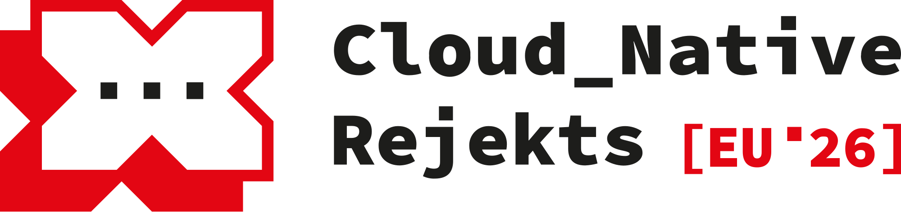

# Cloud Native Rejekts EU 2026, Amsterdam

**Date:** Saturday 21 March 2026
**Status:** Done. Kept here as an example of how an event folder looks.

## Logos

| Logo | Use it on | SVG | PNG | PDF |
| --- | --- | --- | --- | --- |
| Horizontal, colour | Light backgrounds | [SVG](logos/svg/rejekts-2026-eu-amsterdam-logo-horizontal-color.svg) | [PNG](logos/png/rejekts-2026-eu-amsterdam-logo-horizontal-color.png) | [PDF](logos/pdf/rejekts-2026-eu-amsterdam-logo-horizontal-color.pdf) |
| Horizontal, reverse | Dark backgrounds | [SVG](logos/svg/rejekts-2026-eu-amsterdam-logo-horizontal-reverse.svg) | [PNG](logos/png/rejekts-2026-eu-amsterdam-logo-horizontal-reverse.png) | [PDF](logos/pdf/rejekts-2026-eu-amsterdam-logo-horizontal-reverse.pdf) |
| Stacked, colour | Light backgrounds | [SVG](logos/svg/rejekts-2026-eu-amsterdam-logo-stacked-color.svg) | [PNG](logos/png/rejekts-2026-eu-amsterdam-logo-stacked-color.png) | [PDF](logos/pdf/rejekts-2026-eu-amsterdam-logo-stacked-color.pdf) |
| Stacked, reverse | Dark backgrounds | [SVG](logos/svg/rejekts-2026-eu-amsterdam-logo-stacked-reverse.svg) | [PNG](logos/png/rejekts-2026-eu-amsterdam-logo-stacked-reverse.png) | [PDF](logos/pdf/rejekts-2026-eu-amsterdam-logo-stacked-reverse.pdf) |

- **SVG** for websites, **PNG** for slides, documents and social posts (2000 px, transparent), **PDF** for printers.
- Illustrator files are in [logos/ai](logos/ai).
- This set has no black and white one-colour versions, and no X on its own.
